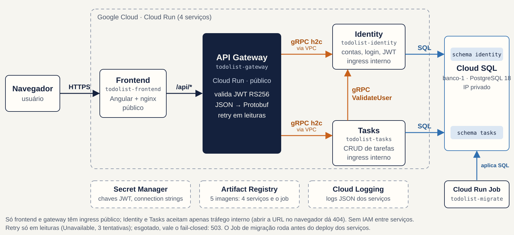

# TodoList distribuído no Cloud Run: relatório técnico da entrega T3

Repositório: https://github.com/felpsgus/projeto-sd (branch `entrega-t3`). Projeto GCP `sd-26-2`, região `us-central1`.

## 1. Contexto de negócio e motivação

O sistema é uma lista de tarefas com login básico. Uma pessoa se cadastra, autentica e gerencia apenas as próprias tarefas (criar, editar, concluir, remover, listar). Fora do escopo: compartilhamento, colaboração, papéis administrativos.

A aplicação é dividida em três serviços .NET 10 (Gateway, Identity, Tasks) e um frontend Angular 22. O Identity é a autoridade de usuário e token. O Tasks guarda as tarefas. O Gateway é a única borda REST pública.

Nas entregas anteriores o sistema rodava em uma VM. No T3 ele passa para serviços gerenciados, pelos motivos abaixo.

| Motivo | Efeito |
|---|---|
| Sem VM para administrar | Zero instâncias no Compute Engine; sem sistema operacional, systemd ou patches |
| Escala a zero | Fora do uso, os serviços não têm instância e não cobram |
| Gasto controlado de crédito | Banco pequeno, ligado só nos ensaios e na apresentação |

O código de negócio não mudou. Mudaram o empacotamento, a configuração, o deploy e uma política de resiliência (seção 4).

## 2. Arquitetura



Fluxo de uma requisição:

1. O navegador abre o **frontend** (nginx, Cloud Run, público). O nginx serve a SPA e repassa `/api/*` para o Gateway pela mesma origem.
2. O **Gateway** (REST, Cloud Run, público) valida o JWT RS256 localmente, com a chave pública.
3. O Gateway chama **Identity** e **Tasks** por gRPC com TLS. Os dois são serviços Cloud Run com ingress `internal`. O Gateway os alcança por **Direct VPC egress**.
4. O Tasks chama o Identity (`ValidateUser`) antes de criar uma tarefa.
5. Identity e Tasks gravam no **Cloud SQL `banco-1`** (PostgreSQL 18, só IP privado, TLS obrigatório), em dois schemas: `identity` e `tasks`.

Ao lado do fluxo:

- **Secret Manager**: chaves JWT e connection strings.
- **Artifact Registry** `todolist`: as imagens.
- **Cloud Logging**: logs JSON dos serviços.
- **Job `todolist-migrate`**: aplica as migrations, Identity antes do Tasks (a FK cruzada depende das tabelas de `identity`). O SQL é idempotente.

## 3. Tecnologias por camada

| Camada | Tecnologia |
|---|---|
| Frontend | Angular 22 (signals, zoneless, OnPush), testes com Vitest, servido por nginx-unprivileged |
| Borda REST | ASP.NET Core 10 (Minimal APIs), JWT Bearer (RS256), FluentValidation, OpenAPI/Scalar |
| Serviços internos | ASP.NET Core 10 com gRPC (`Grpc.AspNetCore`), contratos `.proto` versionados em `contracts/` |
| Cliente gRPC | `Grpc.Net.Client` com `ServiceConfig`/`RetryPolicy` nativos, sem biblioteca extra |
| Persistência | EF Core 10 + Npgsql, PostgreSQL 18 (Cloud SQL), um schema por serviço |
| Logs | Serilog com saída JSON e campo `severity` |
| Plataforma | Cloud Run, Cloud Run Job, Cloud SQL, Secret Manager, Artifact Registry, Cloud Logging, Direct VPC egress |
| Estrutura interna | `Api → Infrastructure → Application → Domain → SharedKernel`; Identity e Tasks sem referência de projeto entre si |

## 4. Resiliência

No Cloud Run, instâncias somem por instantes (cold start, redeploy). A decisão está no ADR-0009 (D-44).

**Retry gRPC nativo (`Grpc.Net.Client`)**

| Parâmetro | Valor |
|---|---|
| Código que dispara | só `StatusCode.Unavailable` |
| Tentativas | 3 por padrão; configurável de 2 a 5 (`Backends:GrpcRetryMaxAttempts` no Gateway, `Identity:RetryMaxAttempts` no Tasks) |
| Backoff | 200 ms a 1 s, multiplicador 2 |
| RPCs com retry | `identity.v1.IdentityService/ValidateUser`, `/GetProfile`, `tasks.v1.TasksService/ListTasks`, `/GetTask` |
| Onde vale | clientes do Gateway (Identity e Tasks) e cliente Identity do Tasks |

Escritas **não** têm retry. Um `CreateTask` que chegou ao Tasks e perdeu a resposta seria duplicado. Login, refresh, cadastro, troca de senha e exclusão de conta também ficam sem retry. Circuit breaker foi rejeitado: complexidade sem ganho com três chamadores. Consequência aceita: com o Tasks fora por muito tempo, cada leitura gasta as 3 tentativas antes do erro.

**Fail-closed (D-28).** Se o Identity está inalcançável, a resposta é `503` com `Retry-After` e nada é criado. O sistema não "degrada" para aceitar tarefa sem validar o usuário. A regra vale para o Gateway e para o Tasks. Esgotadas as tentativas de leitura, a resposta também é `503`.

**Cena da demo: queda do Tasks.**

1. `demo.ps1 -Action TasksDown` roda `gcloud run services update todolist-tasks --scaling=0`. O serviço não é apagado.
2. Login e perfil continuam funcionando, porque o Identity segue de pé.
3. A lista de tarefas aciona o Gateway, que tenta de novo, desiste e responde `503` com `Retry-After`. O frontend mostra o aviso de indisponibilidade e um botão para tentar de novo.
4. `demo.ps1 -Action TasksUp` volta ao autoscaling (`--scaling=auto`). O botão traz as mesmas tarefas do banco.

**[A CONFIRMAR NO ENSAIO: código gRPC que o Gateway recebe com o Tasks em `--scaling=0` (esperado `Unavailable`; se for outro, ele entra nos retentáveis e no mapeamento para 503) e texto exato do aviso na tela.]**

**Observabilidade.** Os logs saem em JSON (Serilog) com o campo `severity`, que o Cloud Logging reconhece. As retentativas aparecem com o filtro:

```
resource.type="cloud_run_revision"
resource.labels.service_name="todolist-gateway"
jsonPayload.SourceContext="Grpc.Net.Client.Internal.RetryCall"
```

Cada linha traz `Status code: 'Unavailable', Attempt: N, Retry: True|False`.

## 5. Variáveis de ambiente e segredos

- **Configuração por variável de ambiente** no Cloud Run, visível no painel de cada serviço. O separador `:` vira `__` (`Identity__GrpcAddress`). Endereço, porta e protocolo nunca são literais no código; um teste de arquitetura falha se aparecer literal fora de `appsettings*.json`.
- **Segredos no Secret Manager**, nenhum versionado nem em texto puro no painel.
  - Chave privada JWT: montada como arquivo no Identity (`Jwt__PrivateKeyPath`).
  - Chave pública JWT: montada como arquivo no Gateway (`Jwt__PublicKeyPath`).
  - Connection strings e senha do banco: referência ao secret, não o valor.
- **Uma conta de serviço por serviço** (e uma para o job), com `secretAccessor` só nos secrets que ele usa. A chave privada só chega ao Identity.
- **Banco**: `SSL Mode=Require`, `Maximum Pool Size` pequeno e `--max-instances 2` em Identity e Tasks, para caber nas conexões do `db-f1-micro`.

## 6. URLs HTTPS

| Serviço | URL | Acesso |
|---|---|---|
| frontend | https://todolist-frontend-2elcb3luiq-uc.a.run.app | público |
| gateway | https://todolist-gateway-2elcb3luiq-uc.a.run.app | público |
| identity | https://todolist-identity-2elcb3luiq-uc.a.run.app | interno (ingress `internal`; de fora responde 404) |
| tasks | https://todolist-tasks-2elcb3luiq-uc.a.run.app | interno (idem) |

A exposição é uma escolha de projeto (D-32 e D-45): o Gateway é a única borda pública, e o 404 nas URLs internas prova a não exposição. A barreira é só o ingress, sem IAM entre serviços. Para expor tudo, basta `deploy.ps1 -Exposure Public`. **[A CONFIRMAR COM O PROFESSOR]** se a exposição interna é aceita.

## 7. Containers e Dockerfiles

- **Imagens .NET**: multi-stage (`sdk:10.0` compila; `aspnet:10.0-noble-chiseled-extra` executa). A imagem final não tem shell e roda como não-root (uid 1654). A camada de restore é separada da de publish, para reaproveitar cache.
- **Frontend**: multi-stage (`node:24.21.0-alpine` compila; `nginxinc/nginx-unprivileged:alpine` serve na porta 8080, não-root). O nginx lê o upstream do Gateway de `GATEWAY_UPSTREAM`, com esquema `https://`.
- **Migração**: `alpine:3.23` com só o cliente `postgresql18-client` e os dois SQL; `USER nobody`.

| Imagem | Antes do BE-44 | Depois |
|---|---|---|
| identity | 393 MB | 292 MB |
| tasks | 388 MB | 287 MB |
| gateway | 348 MB | 247 MB |
| frontend | 83 MB | 83 MB |
| migrate | 433 MB (`postgres:18-alpine`) | 26,9 MB |

As imagens são publicadas no Artifact Registry `us-central1-docker.pkg.dev/sd-26-2/todolist` por `scripts/publish-images.ps1`. A tag é o SHA do commit (`3d8c8e8` no deploy de 26/11/2026), imutável por revisão.

## 8. Validação

| Verificação | Resultado |
|---|---|
| Smoke `deploy/cloudrun/smoke.sh` contra a URL HTTPS do frontend, 26/11/2026 | passou nos 11 passos |
| Rota do SPA | 200 |
| Sem token, token lixo e token adulterado | 401 nos três |
| Cadastro | 201 |
| Login | 200 |
| Título vazio | 400 |
| Criação de tarefa | 201 com `Location` |
| Tarefa criada | aparece na listagem |
| Compute Engine (`gcloud compute instances list`) | 0 itens |

**Custo.** O banco é `db-f1-micro`, dimensionado para o volume da demo. Fora do uso ele fica parado: `demo.ps1 -Action Cooldown` zera `min-instances` e para a instância. `-Action Warmup` liga tudo cerca de 30 min antes da apresentação, para evitar cold start ao vivo.

**Consulta no banco sem IP público.** O IP público do `banco-1` foi desligado. A consulta aos dados é pelo Cloud SQL Studio, no console. **[A CONFIRMAR NO ENSAIO: a consulta no Cloud SQL Studio funciona com o banco sem IP público. Se não funcionar, liga-se o IP público temporariamente, como descrito no runbook.]**

## 9. Repositório

https://github.com/felpsgus/projeto-sd, branch `entrega-t3`. Runbook e scripts em `deploy/cloudrun/` (`provision.ps1`, `deploy.ps1`, `demo.ps1`, `smoke.sh`). Decisões em `docs/adr/0009-*.md` e `tarefas/backend/DECISOES-PENDENTES.md` (D-28, D-32, D-38, D-44, D-45).
